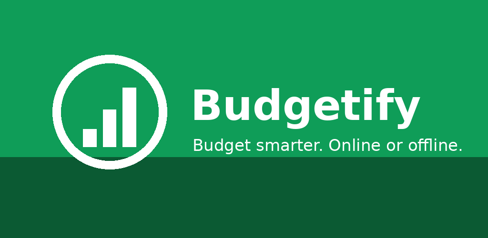
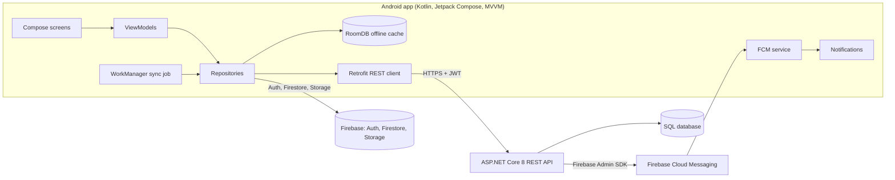
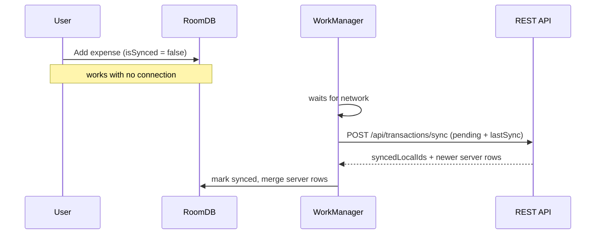

<p align="center"></p>

# Budgetify — Final PoE (Part 3)

**Student:** Lesedi Raseruthe (ST10442607) · **Module:** Open Source Coding (Intermediate) — OPSC6312
**Version:** 2.0.0 (final PoE) · **Demo video:** `(https://github.com/MrThomo/Budgetify/blob/main/VID-20261105-WA0000.mp4 YouTube keeps removing our video)` *(unlisted)*

Budgetify is a budget-tracking Android app for South African users. You log expenses against monthly category budgets, even with **no internet**, and the app syncs them when you reconnect, warns you by push notification when a budget is close to running out, rewards good habits with points and badges, and speaks **English, isiZulu and Sesotho**.

---

## 1. Purpose and design

Part 1 compared YNAB, EveryDollar and Spendee and found three gaps for South African users: they need constant connectivity (data is expensive and patchy), they feel like spreadsheets, and none support local languages. Budgetify's three innovative features answer those gaps:

| Innovation (from Part 1) | How it is implemented |
|---|---|
| **Offline-first sync** | Expenses are written to RoomDB first; WorkManager pushes them to the API as soon as a connection exists |
| **Gamified budgeting** | Points, day-streaks and six badges, stored in Firestore (NoSQL) |
| **Local-language support** | Full UI, error messages *and* push notifications in English / isiZulu / Sesotho |

### Architecture



### Offline sync flow



---

## 2. Features (Part 3)

| Requirement | Where |
|---|---|
| Register / log in, **encrypted password** | BCrypt (work factor 12) in `PasswordService.cs`; JWT kept in `EncryptedSharedPreferences` |
| **Single sign-on (SSO)** | Sign in with Google → Credential Manager → `POST /api/auth/google` (server verifies the token) + Firebase Auth |
| **Settings** | Currency, dark theme (applies live), notifications, language — stored locally and via `GET/PUT /api/settings` |
| **REST API + database** | ASP.NET Core 8 + EF Core (SQLite / Azure SQL), documented in Swagger |
| **Offline mode with sync** | RoomDB + WorkManager + `/api/transactions/sync` (idempotent) |
| **Real-time notifications** | Firebase Cloud Messaging; server pushes budget alerts at 80 % / 100 % of a limit |
| **Multi-language** | English, isiZulu, Sesotho (`values/`, `values-zu/`, `values-st/`) |
| **Blob storage** | Receipt photos uploaded to Firebase Storage |
| **NoSQL database** | Points, streak and badges written to / read from Cloud Firestore |
| **App icon and assets** | Adaptive icon, notification icon, Play Store graphics in `store-listing/` |
| Part 1 features | Categories and budgets, expense tracking, progress bars, gamification |

---

## 3. Screenshots

> Add your own phone screenshots to `docs/images/` and update these links.

| Login | Home | Add expense |
|---|---|---|
|  |  |  |

| Budgets | Rewards | Settings (isiZulu) |
|---|---|---|
|  |  |  |

---

## 4. Running it

Full step-by-step instructions (Firebase, hosting, signing) are in **[`docs/SETUP_CHECKLIST.md`](docs/SETUP_CHECKLIST.md)**.

```bash
# Backend
cd backend/Budgetify.Api && dotnet run          # http://localhost:5000 (Swagger at /swagger)
# Backend tests
dotnet test backend/Budgetify.Api.Tests
# Android unit tests (needs Gradle 8.13 or the wrapper)
cd android-app && gradle testDebugUnitTest
```

Set `BUDGETIFY_API_URL` in `android-app/gradle.properties` to your hosted API and put your `google-services.json` in `android-app/app/`.

---

## 5. Version control, GitHub Actions and testing

* Repository initialised with this README; work committed regularly; the final commit is tagged **`final-PoE`**.
* **`.github/workflows/ci.yml`** runs on every push/PR:
  1. **Android job** – JDK 17, Gradle 8.13, `testDebugUnitTest`, `assembleDebug`, uploads the APK and test report.
  2. **Backend job** – .NET 8, restore, build, `dotnet test` (unit + in-memory integration tests).
* **`.github/workflows/release.yml`** runs on a `v*` / `final-PoE` tag: decodes the keystore from a GitHub secret, builds a **signed release APK and AAB**, and attaches them to a GitHub Release together with `RELEASE_NOTES.md`.

### Automated tests

| Suite | What it covers |
|---|---|
| `InputValidatorTest` | email / password rules, amount parsing, invalid-input rejection |
| `BudgetMathTest` | monthly totals, category status, 80 % / 100 % alert thresholds |
| `GamificationEngineTest` | points, streaks (gaps, malformed dates), every badge rule |
| `ApiServiceTest` | Retrofit client vs. MockWebServer: URLs, verbs, JSON, bearer header, parsing |
| `FormattersTest` | currency formatting |
| `UnitTests.cs` (backend) | BCrypt hashing / salting, budget threshold rule |
| `ApiIntegrationTests.cs` (backend) | register, duplicate email, login, auth-protected settings, seeded categories, idempotent offline sync, input rejection |

---

## 6. Code quality

Every class carries KDoc / XML-doc comments, and `Log.d/i/w/e` (Android) and `ILogger` (API) record what the app is doing at each step (login, sync, push, uploads). The app validates input before it reaches the network and never crashes on bad input or a failed request: every repository call is wrapped, and the UI shows a translated message instead.

## 7. Publishing to Google Play

* `targetSdk 36` (Google Play requirement since 31 Aug 2026), `minSdk 26`, `versionCode 2`, `versionName 2.0.0`
* Signed release APK + AAB produced by `release.yml`; HTTPS-only in release (cleartext is permitted in the debug build only)
* Store assets: [`store-listing/`](store-listing/) (512 px icon, 1024×500 feature graphic, listing text)
* Evidence (signed APK, screenshots, Play Console upload) is listed in the release notes.

## 8. Release notes

See **[`RELEASE_NOTES.md`](RELEASE_NOTES.md)** — everything added since the Part 2 prototype, and which innovative features arrived in this version.

## 9. AI tool usage

See **[`AI_USAGE.md`](AI_USAGE.md)**.

## 10. References

* Android Developers (2026) *Target API level requirements for Google Play*. https://developer.android.com/google/play/requirements/target-sdk
* Firebase (2025) *Cloud Messaging*. https://firebase.google.com/docs/cloud-messaging [Accessed 03 November 2025]
* GitHub (2025) *Automated build Android app with GitHub Action*. https://github.com/marketplace/actions/automated-build-android-app-with-github-action [Accessed 03 November 2025]
* IMAD5112 (2025) *build.yml*. https://github.com/IMAD5112/Github-actions/blob/main/.github/workflows/build.yml [Accessed 03 November 2025]
